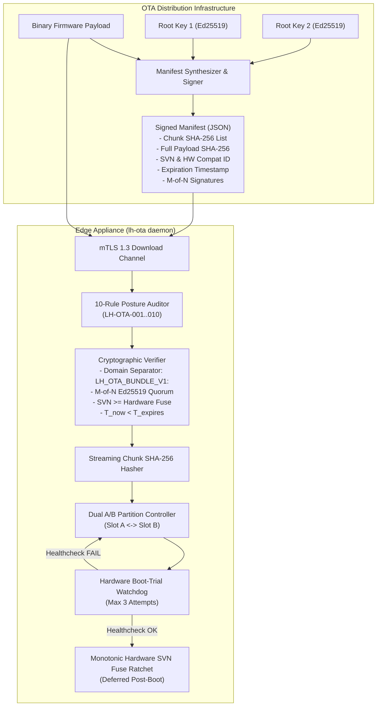

# lh-secure-ota-daemon (`lh-ota`)

[](https://github.com/Logihertz-Systems-OPC-Pvt-Ltd/lh-secure-ota-daemon/actions/workflows/ci.yml)
[](LICENSE)
[](https://go.dev/)
[-success.svg)](go.mod)
[](https://docs.oasis-open.org/sarif/sarif/v2.1.0/sarif-v2.1.0.html)

A production-grade, zero-external-dependency **Go Atomic Dual A/B Partition Over-The-Air (OTA) Firmware Updater, RFC 8032 Ed25519 M-of-N Cryptographic Bundle Verifier, Boot-Trial Rollback State Machine, and 10-Rule Embedded OTA Security Posture Auditor**.

Developed as Repository #46 of the Logihertz 60-Tool Open-Source Ecosystem.

---

## Table of Contents
- [Key Features](#key-features)
- [System Architecture](#system-architecture)
- [Dual A/B Partition State Machine](#dual-ab-partition-state-machine)
- [Cryptographic Invariants & Math](#cryptographic-invariants--math)
- [10-Rule Embedded OTA Posture Auditor](#10-rule-embedded-ota-posture-auditor)
- [Installation & Build](#installation--build)
- [CLI Reference & Usage](#cli-reference--usage)
- [Verification & Testing](#verification--testing)
- [License & Attribution](#license--attribution)

---

## Key Features

- **100% Zero External Dependencies**: Engineered strictly using the Go 1.22+ standard library (`crypto/ed25519`, `crypto/sha256`, `crypto/subtle`, `encoding/hex`, `encoding/json`). Zero third-party module imports in `go.mod`.
- **RFC 8032 Ed25519 M-of-N Multi-Signature Verification**: Enforces threshold signature validation across pinned root-of-trust keys, domain-separated canonical pre-images (`LH_OTA_BUNDLE_V1:`), and duplicate key rejection.
- **Per-Chunk Streaming Integrity Verification**: Validates 4 KiB streaming chunk SHA-256 digests on-the-fly before writing to non-volatile flash, preventing memory exhaustion and bricking from interrupted downloads.
- **TUF-Inspired Anti-Rollback & Freeze-Attack Protection**: Rejects firmware bundles with Security Version Numbers below the current hardware monotonic counter ($\text{SVN}_{\text{bundle}} < \text{SVN}_{\text{current}}$) or expired validity timestamps ($T_{\text{now}} > T_{\text{expires}}$).
- **Atomic Dual A/B State Machine with Deferred Ratchet**: Coordinates fail-safe partitioning between `SLOT_A` and `SLOT_B`. Hardware SVN monotonic ratchets are strictly deferred until post-boot healthchecks succeed, ensuring automatic watchdog fallback to the known-good slot if a trial boot fails.
- **10-Rule Embedded OTA Posture Auditor**: Comprehensive automated compliance scanner scoring system security ($S \in [0, 100]$) with ANSI terminal tables, canonical JSON, and OASIS SARIF v2.1.0 reporting.

---

## System Architecture



---

## Dual A/B Partition State Machine

The atomic dual A/B partition controller ensures that the device can never be bricked by corrupted firmware, network interruptions, or kernel panics during first boot:

```mermaid
stateDiagram-v2
    [*] --> STANDBY_INACTIVE: Factory Staging

    state SLOT_A {
        ACTIVE_GOOD --> STANDBY_INACTIVE: Staging complete on Slot B & trial passed
    }

    state SLOT_B {
        STANDBY_INACTIVE --> STAGED_PENDING_BOOT: StageUpdate(verified_bundle)
        STAGED_PENDING_BOOT --> BOOT_TRIAL: InitiateRebootToStaged()
        BOOT_TRIAL --> ACTIVE_GOOD: Healthchecks PASS (MarkBootSuccessful & Ratchet SVN)
        BOOT_TRIAL --> BOOT_TRIAL: Healthcheck FAIL (Attempts remaining > 0)
        BOOT_TRIAL --> UNBOOTABLE_ROLLED_BACK: Attempts exhausted (Automatic Rollback to Slot A)
        UNBOOTABLE_ROLLED_BACK --> STANDBY_INACTIVE: ResetUnbootableSlot()
    }
```

### The Deferred Ratchet Invariant
> **CRITICAL SECURITY GUARANTEE**: The hardware monotonic fuse (eFuse / TPM monotonic counter) is **never** ratcheted to the new firmware bundle's $\text{SVN}$ during staging or reboot. It is ratcheted **strictly after** the newly booted operating system passes post-boot application healthchecks (`MarkBootSuccessful`). If watchdog trials fail, the hardware fuse remains at the old version, allowing instant fallback execution on the original active slot.

---

## Cryptographic Invariants & Math

### 1. Canonical Pre-Image Domain Separation
To prevent signature cross-protocol replay, the signed message pre-image $P$ combines a fixed domain separation prefix with deterministic metadata JSON:
$$P = \text{"LH\_OTA\_BUNDLE\_V1:"} \mathbin{\Vert} \text{CanonicalJSON}(\text{Metadata})$$

Where $\text{Metadata}$ comprises:
- `bundle_version`
- `security_version_number` ($\text{SVN}$)
- `hardware_compat_id`
- `issued_at_unix` and `expires_at_unix`
- `payload_size_bytes`
- `payload_sha256_hex`
- `chunk_size_bytes` and `chunk_sha256_list`

### 2. M-of-N Multi-Signature Quorum
Given $N$ candidate signatures $\sigma_1, \ldots, \sigma_N$ and a trusted root-of-trust keyring $\mathcal{K}_{\text{trusted}} = \{(\text{id}_k, \text{pk}_k)\}$, the bundle is valid if and only if:
$$V_{\text{valid}} = \sum_{i=1}^N \mathbf{1}_{\left\{ \text{pk}_i \in \mathcal{K}_{\text{trusted}} \;\land\; \text{Ed25519Verify}(\text{pk}_i, P, \sigma_i) == \text{true} \right\}} \ge M_{\text{quorum}}$$

Subject to the uniqueness constraint: $\forall i \ne j, \;\text{KeyID}_i \ne \text{KeyID}_j$.

### 3. Anti-Rollback & Freeze-Attack Invariants
$$\text{SVN}_{\text{bundle}} \ge \text{SVN}_{\text{hardware\_fuse}}$$
$$T_{\text{issued}} - 300 \le T_{\text{now}} \le T_{\text{expires}}$$
$$\text{HardwareCompatID}_{\text{bundle}} == \text{HardwareCompatID}_{\text{platform}}$$

### 4. Posture Auditor Scoring Math
The posture score $S \in [0, 100]$ deducts points for non-compliant invariants:
$$S = \max\left(0, 100 - \sum_{i=1}^{10} d_i \cdot \mathbf{1}_{\{\text{Rule}_i \text{ failed}\}}\right)$$

| Score Range | Status Classification | Operational Meaning |
|:---:|:---:|:---|
| **90 – 100** | `HARDENED` | Production-ready, all critical invariants verified |
| **70 – 89** | `ACCEPTABLE` | Minor telemetry or low-severity posture gaps |
| **50 – 69** | `DEGRADED` | Significant gaps requiring remediation prior to rollout |
| **0 – 49** | `NON-COMPLIANT` | Critical security failure; flashing blocked |

---

## 10-Rule Embedded OTA Posture Auditor

| Rule ID | Severity | Deduction | CWE | Invariant Evaluated | Remediation Guidance |
|:---|:---:|:---:|:---:|:---|:---|
| **LH-OTA-001** | CRITICAL | -25 | CWE-347 | `signature_verification_enabled == true` && `signature_algorithm == "Ed25519"` | Enable bundle authentication and enforce RFC 8032 Ed25519. |
| **LH-OTA-002** | CRITICAL | -25 | CWE-494 | `dual_ab_partition_scheme == true` && `allow_active_slot_overwrite == false` | Enforce atomic dual A/B partitioning; disallow active slot writes. |
| **LH-OTA-003** | CRITICAL | -25 | CWE-319 | `require_tls_1_3 == true` && `mtls_client_auth_enabled == true` && `!allow_insecure_http_fallback` | Enforce TLS 1.3 with mTLS; forbid unencrypted HTTP fallback. |
| **LH-OTA-004** | HIGH | -10 | CWE-693 | `anti_rollback_svn_enforced == true` && `ratchet_svn_only_after_good_boot == true` | Enforce monotonic SVN anti-rollback and defer ratchet to post-boot. |
| **LH-OTA-005** | HIGH | -10 | CWE-755 | $1 \le \text{boot\_trial\_max\_attempts} \le 5$ && `auto_rollback_on_healthcheck_fail == true` | Configure watchdog boot-trial counter and enable automatic rollback. |
| **LH-OTA-006** | HIGH | -10 | CWE-345 | `min_signature_quorum >= 2` && `enforce_manifest_expiration == true` | Require at least 2 root signatures and enforce freeze-attack expiration. |
| **LH-OTA-007** | HIGH | -10 | CWE-353 | `verify_chunk_hashes_before_write == true` && `bind_dm_verity_roothash == true` | Enable streaming 4 KiB chunk verification and dm-verity binding. |
| **LH-OTA-008** | MEDIUM | -4 | CWE-20 | `verify_hardware_compat_id == true` | Enable cryptographic hardware compatibility ID validation. |
| **LH-OTA-009** | MEDIUM | -4 | CWE-400 | $\text{max\_bundle\_size\_mb} \le 2048$ && $\text{min\_battery\_soc\_percent} \ge 30$ | Bound bundle memory size and gate updates on battery threshold. |
| **LH-OTA-010** | LOW | -1 | CWE-778 | `poll_jitter_enabled == true` && `signed_ota_audit_receipt == true` | Enable randomized poll jitter and signed update audit receipts. |

---

## Installation & Build

### Prerequisites
- Go 1.22 or later
- Linux x86_64 or ARM64

### Compile Binary
```bash
git clone https://github.com/Logihertz-Systems-OPC-Pvt-Ltd/lh-secure-ota-daemon.git
cd lh-secure-ota-daemon
go build -v -ldflags="-s -w" -o bin/lh-ota ./cmd/lh-ota
```

Verify compilation:
```bash
./bin/lh-ota --version
# Output:
# lh-ota v0.1.0
# Copyright (C) 2026 Logihertz Systems (OPC) Private Limited
```

---

## CLI Reference & Usage

### 1. `scan`: Audit Embedded OTA Security Policy
```bash
# Scan policy and output human-readable terminal table
./bin/lh-ota scan fixtures/hardened_ota_policy.json

# Export in canonical JSON format
./bin/lh-ota scan fixtures/hardened_ota_policy.json --format=json

# Export in OASIS SARIF v2.1.0 format
./bin/lh-ota scan fixtures/hardened_ota_policy.json --format=sarif --output=sarif_report.json
```

### 2. `keygen`: Generate Ed25519 Root Key Pair
```bash
./bin/lh-ota keygen --id=signer-alpha --out-pub=root.pub --out-priv=root.priv
```

### 3. `sign-bundle`: Create and Sign Firmware Manifest
```bash
./bin/lh-ota sign-bundle \
  --payload=fixtures/sample_firmware.bin \
  --version=1.2.0 \
  --svn=2 \
  --hw-id=LH-ROBOTICS-AGX-V2 \
  --priv-key=<HEX_PRIVATE_KEY> \
  --key-id=root-signer-01 \
  --out=manifest.json \
  --ttl-hours=720 \
  --chunk-size=4096
```

### 4. `verify-bundle`: Cryptographic & Streaming Validation
```bash
./bin/lh-ota verify-bundle \
  --manifest=fixtures/sample_signed_bundle.json \
  --payload=fixtures/sample_firmware.bin \
  --pub-keys=fixtures/trusted_keyring.json \
  --min-quorum=1 \
  --current-svn=1 \
  --hw-id=LH-ROBOTICS-AGX-V2
```

### 5. `simulate-ab`: Fail-Safe Dual A/B Partition Simulation
```bash
# Happy path: successful update and post-boot deferred ratchet
./bin/lh-ota simulate-ab \
  --initial-slot=SLOT_A \
  --initial-version=1.0.0 \
  --initial-svn=1 \
  --new-version=1.1.0 \
  --new-svn=2

# Rollback path: post-boot healthchecks fail; watchdog activates fallback to Slot A
./bin/lh-ota simulate-ab \
  --initial-slot=SLOT_A \
  --initial-version=1.0.0 \
  --initial-svn=1 \
  --new-version=1.1.0 \
  --new-svn=2 \
  --fail-healthcheck
```

---

## Verification & Testing

Run all unit, integration, and CLI tests with the Go race detector enabled:
```bash
# Verify code formatting
test -z "$(gofmt -s -l .)"

# Static analysis
go vet ./...

# Unit and integration test suite with data race detection
go test -v -race -cover ./...
```

---

## License & Attribution

`lh-secure-ota-daemon` is licensed under the **Apache License, Version 2.0**.
See [LICENSE](LICENSE) and [NOTICE](NOTICE) for full terms.

Copyright (C) 2026 Logihertz Systems (OPC) Private Limited.  
Created, Architected, and Developed by **Sameer Tawade** (`ops@logihertz.com`).
